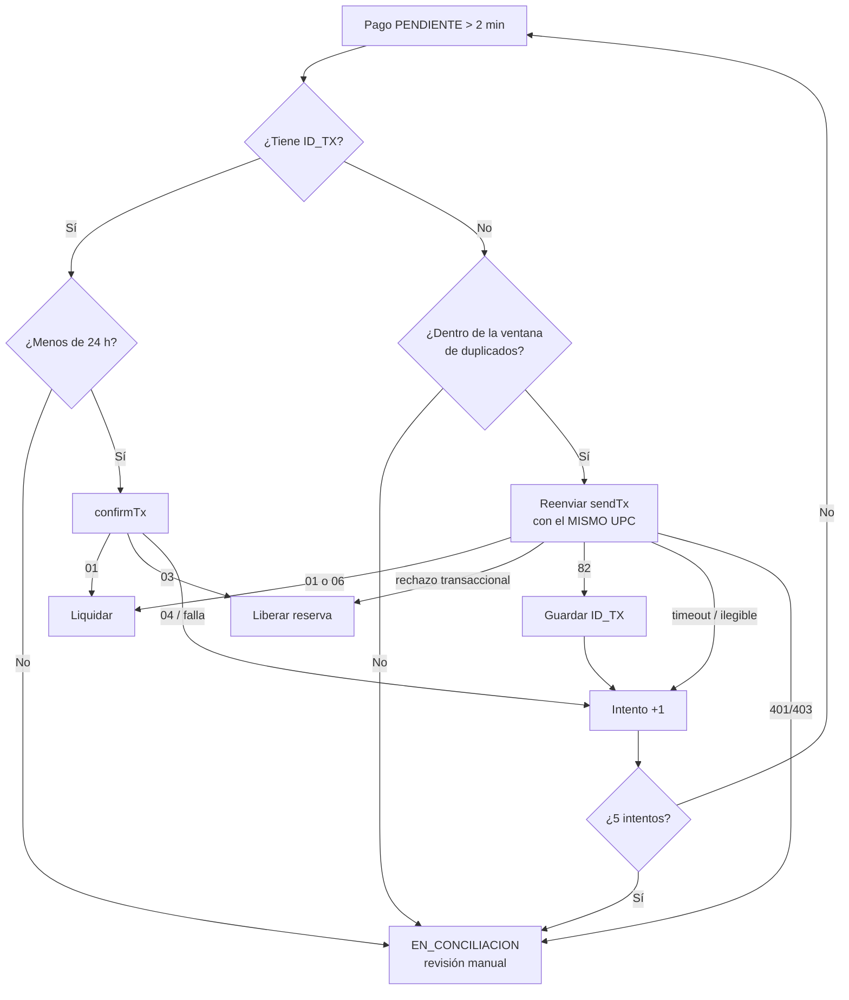

# Integración con Gestopago (PuntoRed): diseño, riesgos y decisiones

Este documento explica cómo el sistema ejecuta un pago de servicio o una recarga de tiempo aire a través de
Gestopago (`POST /sistema/service/sendTx.do`), desde la autenticación del cliente hasta el tratamiento del
resultado, y justifica cada decisión frente a los escenarios de fallo identificados.

> Principio rector: **el saldo del cliente solo se mueve cuando hay una respuesta del proveedor que lo justifica.**
> Un timeout o una respuesta ilegible nunca se interpretan como "no se cobró".

---

## 1. Flujo completo

```mermaid
sequenceDiagram
    autonumber
    actor C as Cliente
    participant API as PagoController
    participant S as PagoServicioService
    participant T as PagoTransaccionalService
    participant DB as PostgreSQL
    participant GP as Gestopago

    C->>API: POST /api/pagos/solicitar-codigo (JWT)
    API->>S: validar titular, cuenta, catálogo, monto, saldo
    S-->>C: código 2FA enviado al correo registrado

    C->>API: POST /api/pagos/aplicar (JWT + código + idempotencyKey)
    API->>S: idempotencia → revalidar todo → validar 2FA
    S->>GP: obtener/renovar token (antes de tocar saldo)
    S->>T: reservarSaldoYCrearPago()
    T->>DB: SELECT ... FOR UPDATE (Saldo) · disponible -= monto · Pago PENDIENTE
    Note over T,DB: transacción corta; el lock se libera al hacer commit
    S->>GP: sendTx (fuera de transacción, form-urlencoded, payload AES-256)
    alt CODIGO 01
        S->>T: aplicarExito() → contable -= monto · EXITOSO
    else rechazo confirmado (02, 06 en primer envío, otros)
        S->>T: aplicarRechazo() → disponible += monto · RECHAZADO
    else timeout, CODIGO 82, XML ilegible, 5xx
        S->>T: registrarTimeout() → sigue PENDIENTE con saldo reservado
        Note over S,GP: lo resuelve la verificación automática (sección 7)
    end
    S-->>C: estatus final o "en proceso"
```

| Capa | Responsabilidad | Clase |
|---|---|---|
| Controller | Recibir el request, extraer el titular del JWT, delegar. Sin lógica ni `try/catch`. | `PagoController`, `ConciliacionController` |
| Service | Validaciones de negocio, orquestación del flujo, interpretación de resultados. | `PagoServicioServiceImpl`, `VerificacionPagosServiceImpl` |
| Service transaccional | Transacciones cortas (`REQUIRES_NEW`) con bloqueo pesimista sobre `Saldo`. | `PagoTransaccionalServiceImpl` |
| Cliente HTTP | Token, cifrado, formato de la trama, traducción de códigos del proveedor a excepciones tipadas. | `PuntoRedClient` |
| Repository | Acceso a datos y locks (`@Lock(PESSIMISTIC_WRITE)`). | `SaldoRepository`, `PagoServicioRepository`, … |
| Manejo de errores | Traducción centralizada a HTTP con `@RestControllerAdvice`. | `GlobalExceptionHandler` |

---

## 2. Seguridad de credenciales e información

| Riesgo | Medida |
|---|---|
| Credenciales en el repositorio | Todas las credenciales (`PUNTORED_PASSWORD`, `PUNTORED_AES_KEY/IV`, `PUNTORED_API_KEY`, `JWT_SECRET`, `ADMIN_*`) se leen de variables de entorno. `.env` está en `.gitignore`; solo se versiona `.env.example` con valores de ejemplo. |
| Token Bearer expuesto | Vive solo en memoria (`AtomicReference`), nunca se escribe en BD, logs ni respuestas. Se renueva 60 s antes del `exp` del JWT o ante HTTP 401/403 (Gestopago responde **403** cuando el token vence). Un `synchronized` con doble verificación evita que varias peticiones simultáneas pidan tokens a la vez. |
| Contraseña en la URL de autenticación | Gestopago exige `idDistribuidor`, `codigoDispositivo` y `password` como query params. Por eso **ningún** mensaje de excepción ni log del cliente incluye `e.getMessage()` de RestClient (que contiene la URI completa); solo se registra el tipo de la causa. Lo cubre una prueba (`PuntoRedClientTest` #9 y #19). |
| Payload en claro | La trama viaja cifrada con AES-256-CBC (`signed`). Teléfono y referencia se excluyen del `toString()` y se enmascaran en logs (`******5432`). |
| Datos internos hacia el proveedor | CURP, RFC, número de cuenta e `idempotencyKey` nunca forman parte del `SendTxPayload`. `tipoFront` es `@JsonIgnore`. |
| Información sensible en errores | Las respuestas siguen el formato `{codigo, mensaje}` con mensajes de catálogo (`ErrorMessage`). `server.error.include-stacktrace=never`. No se reenvían al cliente los mensajes de `IllegalArgumentException`, del SQL (`DataIntegrityViolation`) ni de Jackson. |
| Logs con identificadores financieros | Cuentas enmascaradas (`DatosSensibles.enmascarar`). No se registran saldos, códigos 2FA ni llaves de idempotencia. |

---

## 3. Validaciones antes de ejecutar la operación

Se ejecutan **en ambos pasos** (`solicitar-codigo` y `aplicar`): el segundo paso no confía en que el primero ya validó.

| Requisito | Validación | Respuesta |
|---|---|---|
| Identidad del cliente | JWT firmado y con sesión vigente (`SesionVigenteValidator`: un logout o un login posterior invalidan el token). | 401 |
| Autorización | La CURP/RFC del body debe ser la del titular del JWT, sin revelar si el otro cliente existe. Además, código 2FA de 6 dígitos (SecureRandom, guardado como hash BCrypt, 5 min de vigencia, 3 intentos, un solo uso) **vinculado por SHA-256 a la operación exacta**: cuenta, producto, servicio, teléfono, referencia y monto. Si cambias el monto después de recibir el código, el código deja de servir. | 403 / 400 |
| Cuenta activa | El cliente está activo, la cuenta le pertenece y tiene estatus `ACTIVA`. | 400 |
| Producto en catálogo | `idProducto` existe y está activo en el catálogo **local**, y `idServicio` coincide con el registrado. Solo se permiten recargas (`tipoFront` 0) y servicios (1, 2). | 400 |
| Monto válido | Mayor que 0, máximo 2 decimales y dentro de `[montoMinimo, montoMaximo]` del producto, o de los límites globales. Para paquetes de monto fijo, mínimo = máximo, lo que impide manipular el monto. | 400 |
| Datos completos | Teléfono de 10 dígitos para recargas; referencia de 1 a 100 caracteres para servicios. Además, Bean Validation en los DTO y `fail-on-unknown-properties=true`. | 400 |
| Saldo suficiente | Se verifica al validar y **se vuelve a verificar bajo lock** al reservar (la verificación previa sola permitiría una carrera). | 400 |
| Duplicados | `idempotencyKey` obligatoria con índice único. Ver sección 5. | 200 (idempotente) / 409 |

El catálogo local se sincroniza con `getProductList.do`, que Gestopago limita a **3 llamadas diarias**. El cupo
se controla en BD (`consultas_proveedor_diarias`) con bloqueo de fila y se consume *antes* de la llamada, porque
el proveedor cuenta peticiones y no éxitos. Si la última sincronización exitosa tiene menos de 20 h, no se
vuelve a consultar, así los reinicios no gastan cupo.

---

## 4. Estrategia de descuento: reserva y después liquidación

**Decisión:** el `Saldo` tiene dos campos. `saldoDisponible` baja **antes** de llamar al proveedor (reserva) y
`saldoContable` baja solo cuando Gestopago confirma (liquidación). Un rechazo confirmado devuelve la reserva.

| Alternativa | Por qué se descartó |
|---|---|
| Descontar después de que el proveedor responda | Entre la verificación y el descuento, otra petición puede gastar el mismo saldo, y Gestopago ya habría entregado el servicio. Sobregiro. |
| Descontar todo antes y "revertir" si falla | Ante un timeout no se sabe si hay que revertir. Revertir a ciegas regala dinero; no revertir cobra servicios no entregados. Además mezcla un movimiento real con uno provisional. |
| Mantener el lock de BD mientras se llama al proveedor | Gestopago puede tardar hasta 62 s. Un lock de ese tamaño bloquea toda operación de la cuenta y agota el pool de conexiones. |
| **Reserva → llamada sin lock → liquidación o liberación en transacciones cortas** | El saldo comprometido no se puede gastar dos veces, el lock dura milisegundos y el estado intermedio (`PENDIENTE`) queda explícito y es auditable. **Elegida.** |

Antes de reservar se obtiene el token. Si el proveedor no está disponible en ese punto, se responde 503 sin
tocar el saldo, porque la transacción nunca se envió.

---

## 5. Prevención de cargos duplicados y control de concurrencia

| Amenaza | Defensa |
|---|---|
| El cliente repite la petición (doble clic, reintento del frontend o de la red) | `idempotencyKey`: si ya existe, se devuelve el resultado original sin volver a cobrar. Si la llave se reutiliza con **otros** datos se responde 409, y si pertenece a otro cliente, 403. |
| Dos peticiones simultáneas con la misma llave | Ambas pasan la consulta inicial, pero el índice único de `idempotency_key` deja insertar solo una. La perdedora se revierte por completo (incluida su reserva) y responde con el resultado de la ganadora. Probado en `PagoTransaccionalConcurrenciaIT`. |
| Varias operaciones distintas sobre la misma cuenta en paralelo | `SELECT ... FOR UPDATE` sobre `Saldo` serializa las reservas; la revalidación del saldo bajo lock impide el sobregiro. Probado con 10 hilos concurrentes. |
| Liquidar o devolver dos veces el mismo pago (respuesta tardía + verificación + conciliación manual) | `aplicarExito` y `aplicarRechazo` toman el lock del saldo y solo actúan sobre pagos en `PENDIENTE` o `EN_CONCILIACION`; un pago cerrado lanza `PAGO_NO_CONCILIABLE`. |
| Reenvío al proveedor que genere un segundo cargo | Cada pago tiene un **UPC** único (≤ 15 caracteres) que se reutiliza idéntico en cualquier reenvío. Gestopago rechaza el mismo UPC como duplicado (`06`) dentro de su ventana; fuera de ella nunca se reenvía (sección 7). |

---

## 6. Interpretación de las respuestas del proveedor

| Respuesta de `sendTx` | Significado | Acción en el primer envío | Acción en un reenvío del mismo UPC |
|---|---|---|---|
| `01` | Operación aplicada | Liquidar | Liquidar |
| `06` | "Transacción aplicada anteriormente" | **Rechazo**: el UPC es nuevo, así que el duplicado es de *otra* operación (mismo servicio y monto en 24 h). Esta no se cobró. | **Liquidar**: la operación original sí se aplicó |
| `82` | Gestopago agotó sus 62 s; trae `ID_TX` | Resultado desconocido: queda `PENDIENTE` y se guarda el `ID_TX` | Igual |
| `02` y otros códigos | Rechazo de la operación | Liberar la reserva | Liberar (si la original se hubiera aplicado, la respuesta sería `06`) |
| Timeout de red, 5xx, XML ilegible | Desconocido | `PENDIENTE` con saldo reservado | Contar intento; escalar al agotarlos |
| HTTP 401/403 | Token inválido o vencido | Renovar el token y reenviar **la misma trama** una vez; si persiste, rechazo (la petición no se procesó) | **Nunca** liberar saldo: no dice nada de la operación original. Escalar. |

Códigos no documentados como éxito (`00`, `0`) se tratan como rechazo. El read timeout es de **70 s**, por
encima de los 62 s del proveedor: cortar antes solo genera resultados desconocidos que Gestopago sí habría resuelto.

---

## 7. Verificación automática y conciliación

Un scheduler revisa cada 2 min los pagos `PENDIENTE` con más de 2 min de antigüedad. Ese margen es mayor que
el read timeout, así el scheduler no compite con la petición original que todavía espera respuesta.



**Ventana de reenvío.** Gestopago detecta el UPC repetido durante 15 min en recargas y 24 h en pagos de
servicios. Se usan 10 min y 23 h para dejar margen. Fuera de esa ventana, un reenvío sería procesado como una
venta **nueva** (doble cargo), así que no se hace. Si el producto ya no está en el catálogo y no se puede saber
su tipo, se aplica la ventana corta.

**Conciliación manual** (`/api/admin/pagos/*`, rol ADMIN con HTTP Basic):

- `en-conciliacion`: lista los pagos que la verificación no pudo resolver.
- `verificar`: lanza la verificación automática para un UPC.
- `conciliar`: cierra el pago con la evidencia que el operador obtuvo del proveedor (portal, reporte o soporte): liquida o libera.

---

## 8. Escenarios de fallo

| # | Escenario | Estado final | Saldo del cliente |
|---|---|---|---|
| 1 | Datos inválidos, producto inexistente o monto fuera de rango | Sin registro | Intacto |
| 2 | Saldo insuficiente (incluso si se agota por una petición concurrente) | Sin registro | Intacto |
| 3 | Código 2FA incorrecto, expirado, reutilizado o de otra operación | Sin registro | Intacto |
| 4 | Gestopago no disponible al pedir el token | Sin registro (503) | Intacto |
| 5 | Gestopago aprueba (`01`) | `EXITOSO` | Contable y disponible descontados |
| 6 | Gestopago rechaza (`02`, `06` en primer envío, etc.) | `RECHAZADO` | Reserva devuelta |
| 7 | Timeout de red tras enviar | `PENDIENTE` → verificación | Reservado hasta tener certeza |
| 8 | Gestopago responde `82` | `PENDIENTE` + `ID_TX` → `confirmTx` | Reservado hasta tener certeza |
| 9 | Respuesta ilegible o 5xx | `PENDIENTE` → verificación | Reservado |
| 10 | La aplicación se cae entre la reserva y el envío | `PENDIENTE` → el reenvío del mismo UPC lo procesa o confirma | Reservado |
| 11 | La aplicación se cae después de que Gestopago aprobó | `PENDIENTE` → el reenvío obtiene `06` → liquidar | Reservado → descontado |
| 12 | Doble envío del cliente / misma llave en paralelo | Un solo pago | Un solo cargo |
| 13 | Token vencido durante el envío | Renovación transparente y reenvío de la misma trama | Según la respuesta |
| 14 | Sin certeza fuera de ventana o tras 5 intentos | `EN_CONCILIACION` | Reservado hasta la resolución manual |

---

## 9. Respuestas HTTP

| Situación | HTTP |
|---|---|
| Validación de DTO, regla de negocio, saldo insuficiente, 2FA inválido, cupo de catálogo agotado | 400 |
| Sin JWT o sesión no vigente | 401 |
| Operar sobre un cliente o cuenta ajenos, o llave de idempotencia de otro cliente | 403 |
| Cliente o cuenta inexistentes | 404 |
| Llave de idempotencia reutilizada con otros datos, conflicto de integridad | 409 |
| Error de autenticación con el proveedor | 502 |
| Proveedor no disponible antes de reservar (sin cargo) | 503 |
| Error no controlado (mensaje genérico; detalle solo en el log) | 500 |

Un resultado desconocido **no** es un error HTTP: se responde 200 con `estatus: PENDIENTE` y el mensaje
"Pago en proceso", porque la solicitud del cliente sí quedó registrada.

---

## 10. Supuestos y riesgos residuales

- **Formato de `confirmTx`.** La colección de Postman lo muestra como form normal (`idDistribuidor`,
  `idTransaccion`), sin cifrar. Así está implementado; debe confirmarse contra el sandbox.
- **Reenvío de un pago de servicio no procesado.** Si el envío original no llegó, el reenvío lo ejecuta en ese
  momento (hasta 23 h después). Se considera aceptable porque el dinero estaba reservado y al cliente se le
  respondió "en proceso", pero el pago se aplica más tarde de lo solicitado.
- **`06` por monto repetido.** Gestopago marca como duplicado el mismo servicio con el mismo monto en 24 h. Un
  cliente que pague dos recibos distintos del mismo servicio por el mismo monto verá rechazado el segundo; es
  una regla del proveedor.
- **Varias instancias del scheduler.** Dos instancias podrían reenviar el mismo UPC a la vez. El proveedor
  responde `06` a la segunda y solo una liquidación tiene efecto, porque el pago ya cerrado se rechaza bajo lock.
- **Sin endpoint de reverso.** Gestopago no documenta cancelaciones; un pago `EXITOSO` no se revierte desde el sistema.

---

## 11. Pruebas

| Área | Pruebas |
|---|---|
| Formato de la trama, códigos `01/02/06/82/00`, 401/403, `X-API-Key`, `confirmTx`, que ningún secreto llegue a los logs | `PuntoRedClientTest` (MockWebServer) |
| Validaciones del flujo, 2FA, idempotencia, suplantación, timeout y rechazo | `PagoServicioFlowTest`, `PagoSeguridadFlowTest`, `CodigoVerificacionServiceTest` |
| Reservas concurrentes, misma llave en paralelo, doble liquidación | `PagoTransaccionalConcurrenciaIT` (H2) |
| Cada rama de la verificación automática y sus ventanas | `VerificacionPagosServiceTest` |
| Cupo diario del catálogo, incluso con concurrencia | `CuotaConsultaProveedorIT` (H2), `ConciliacionYCatalogoTest` |
| Reconstrucción del payload con el mismo UPC, sin fuga de datos internos | `PagoServicioServiceTest` |
| Seguridad HTTP (JWT, roles, sesión) y traducción de errores | `AuthSeguridadIT`, `PagoControllerTest`, `GlobalExceptionHandlerTest` |

Ejecutar: `./gradlew test`

---

## 12. Configuración relevante

Ver [`.env.example`](../.env.example). Las variables específicas de esta integración son:

| Variable | Valor por defecto | Propósito |
|---|---|---|
| `PUNTORED_ID_DISTRIBUIDOR`, `PUNTORED_CODIGO_DISPOSITIVO`, `PUNTORED_PASSWORD` | — | Autenticación JWT |
| `PUNTORED_AES_KEY`, `PUNTORED_AES_IV` | — | Cifrado de la trama (Base64, 32 y 16 bytes) |
| `PUNTORED_API_KEY` | vacío | Header `X-API-Key`, solo si el proveedor lo asignó |
| `PUNTORED_READ_TIMEOUT` | `70000` | Debe ser mayor que los 62 s del proveedor |
| `PUNTORED_MINUTOS_ANTES_VERIFICAR` | `2` | Antigüedad mínima antes de verificar un pendiente |
| `PUNTORED_VENTANA_REENVIO_RECARGA` / `_SERVICIO` | `10` / `1380` | Ventana segura para reenviar el mismo UPC (minutos) |
| `PUNTORED_MAX_INTENTOS_VERIFICACION` | `5` | Intentos antes de escalar a conciliación manual |
| `PUNTORED_CATALOGO_LIMITE_DIARIO` / `_HORAS_ENTRE_SYNC` | `3` / `20` | Cupo de `getProductList.do` |
